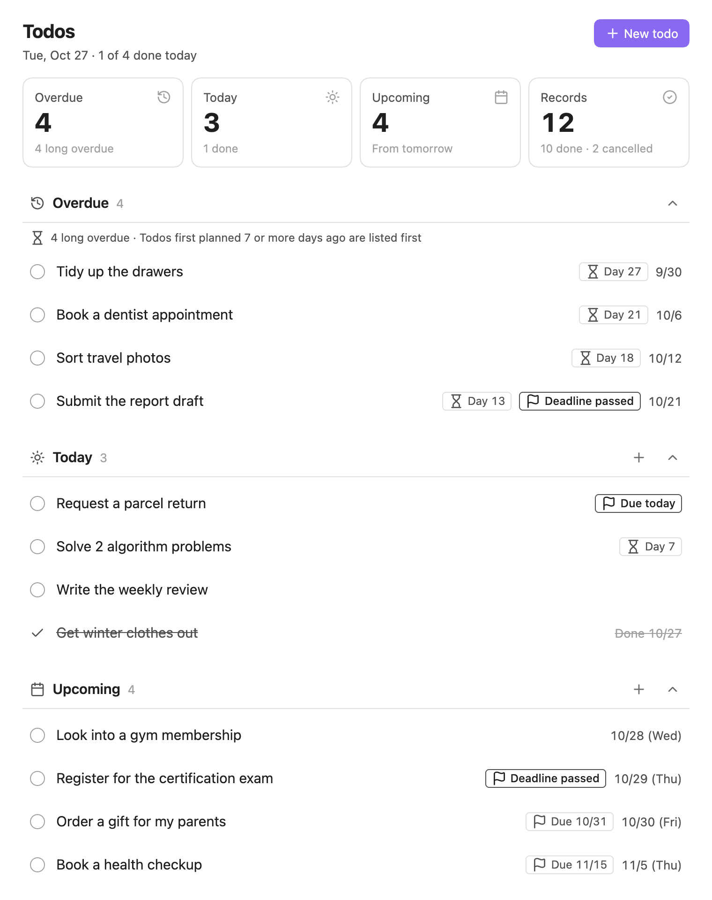
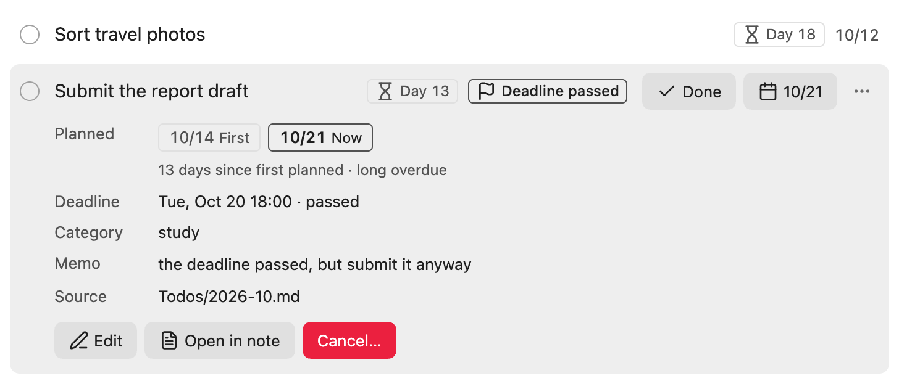

# Todo Tracker

[한국어](README.ko.md)

Track todos written in monthly Markdown notes, grouped into overdue, today and upcoming. Changes you make in the view are written back to the note right away, and edits to the note show up in the view.



## Features

- **Overdue, today and upcoming**: Open todos are grouped by their `planned` date.
- **Long-overdue highlight**: Todos first planned 7 or more days ago get a `Day N` chip and move to the top of Overdue.
- **Deadline chips**: Todos with a passed or upcoming deadline get a chip.
- **Filters**: Filter by deadline, category or text.
- **Quick complete**: Tap the circle to mark a todo as done today, and undo it from the notice.
- **Reschedule, edit, cancel**: From the todo menu, mark it done on another day, change its date, edit it or cancel it. Done and cancelled todos can be changed or undone too.
- **Two-way sync with notes**: Changes in the view go to the note, and edits to the note show up in the view.
- **English and Korean**: The UI follows the Obsidian language. Notes can use English or Korean field names.
- **Works with AI agents**: Put the [format guide](#using-with-ai-agents) in the todo folder so AI agents edit todos in the right format.



## Getting started

### Installation

#### Community plugins

Open Settings → Community plugins → Browse, search for `Todo Tracker`, then install and enable it.

#### Manual

1. Download `main.js`, `manifest.json` and `styles.css` from the [releases](https://github.com/yoouyeon/todo-tracker/releases).
2. Put the three files in `.obsidian/plugins/todo-tracker/` in your vault.
3. Reload Obsidian and enable `Todo Tracker` in Settings → Community plugins.

Requires Obsidian 1.13.0 or later. Works on desktop and mobile.

### Your first todo

Create a note named after this month (for example `2026-10.md`) in the `Todos` folder and write a todo.

```markdown
- [ ] Submit the report draft
  - planned: 2026-10-18
```

Click the `Open todos` ribbon icon, or run `Todo Tracker: Open todos` from the command palette.

## Using with AI agents

To let AI agents such as Claude Code or Codex read and edit todos in the month note format, put the [guide for AI agents](docs/ai/AGENTS.md) in the todo folder.

1. Download [`docs/ai/AGENTS.md`](docs/ai/AGENTS.md). For Korean field names, use [`docs/ai/AGENTS.ko.md`](docs/ai/AGENTS.ko.md).
2. Save it in the todo folder (`Todos` by default) as:
   - Claude Code: `CLAUDE.md`
   - Other agents: `AGENTS.md`

Agents read this guide when they work with files in the todo folder. Some tools don't read guide files in subfolders automatically. In that case, run the agent from the todo folder or tell it to read this file first.

The plugin doesn't read this file as todos. It shows up as a note in the todo folder in the Obsidian file list.

## Note format

Only `YYYY-MM.md` files directly in the folder you set (`Todos` by default) are read.

```text
Todos/
├── 2026-09.md
└── 2026-10.md
```

A month note looks like this.

```markdown
---
# month matches the file name; the plugin keeps open up to date
month: 2026-10
open: true
---

<!-- Put each todo in the file of the month it was first planned -->

<!-- Open -->
- [ ] Submit the report draft
  - first planned: 2026-10-14
  - planned: 2026-10-18
  - deadline: 2026-10-17 18:00
  - category: study
  - memo: draft only

<!-- Done -->
- [x] Morning stretch
  - planned: 2026-10-18
  - completed: 2026-10-18

<!-- Cancelled -->
- [-] Buy a one-day gym pass
  - planned: 2026-10-11
  - cancelled: 2026-10-12
  - reason: a new gym opened nearby
```

Dates are written as `YYYY-MM-DD`.

| Field | Description |
|---|---|
| `first planned` | The date first planned. If missing, it is the same as `planned`. |
| `planned` (required) | The date currently planned. |
| `deadline` | A date, or `YYYY-MM-DD HH:mm` |
| `completed`, `cancelled` | For done or cancelled todos. |
| `reason` | Why it was cancelled |
| `category` | Used for filtering |
| `alias` | Other names used in search. Can't be edited in the view. |
| `memo` | Free-form memo |

Field names are lowercase. The plugin also reads the Korean field names (`하기로 한 날` and so on), so a note can use either language. See the [Korean README](README.ko.md#note-format) for the Korean names.

Fields the plugin doesn't know are not read. Todos with unknown fields are listed under `Needs attention` at the bottom of the view.

## Settings

- **Todo folder**: The folder with month notes. Defaults to `Todos` (`할일` when Obsidian is in Korean). Leave it empty to read the vault root.
- **Note language**: The language of field names the plugin writes. Both languages are always read. Defaults to Korean when Obsidian is in Korean, and English otherwise.
- **Convert note field names**: Changes the field names in existing month notes to the note language. Values and titles stay the same. Also available as the command `Todo Tracker: Convert note field names to the note language`.

## License

[MIT](LICENSE)
